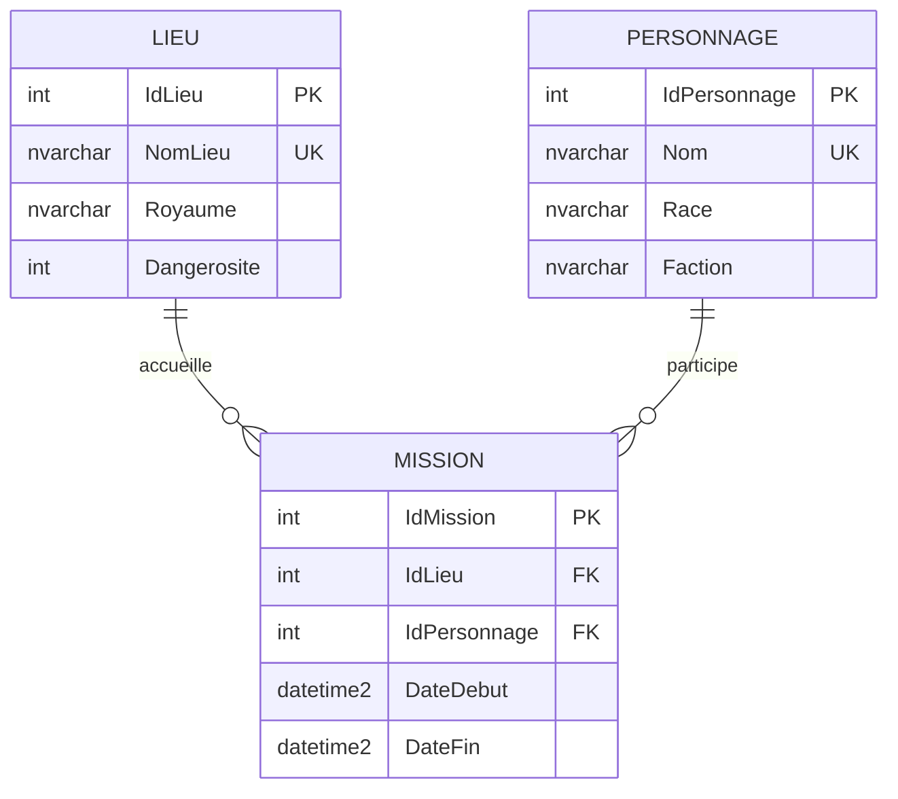

# Réservations de Lieux — Seigneur des Anneaux (WinForms, SQL FIRST, ADO.NET)

## Description

Application Windows Forms destinée au Haut Conseil de la Terre du Milieu. Elle permet de gérer les **lieux**, les **personnages** et de **planifier des missions** sur des plages de temps, sans chevauchement dans un même lieu.

Technologies :

- Windows Forms (.NET 8, Windows)
- SQL Server LocalDB (`TP1_LSDA`)
- ADO.NET uniquement (aucun Entity Framework, aucune migration)
- Repository Pattern (`IRepository<T>`, `RepositoryBase<T>`, dépôts spécialisés)

L’interface n’exécute aucune instruction SQL : tout passe par les repositories.

## Architecture

```
TP1_ReservationsLieux.sln
README.md
equipe.txt
captures/
    diagramme-bd.svg
DatabaseScripts/
    create_database.sql
    create_tables.sql
    insert_data.sql
ReservationsLieux/
    App.config
    Program.cs
    DatabaseInitializer.cs
    Domain/
        Lieu.cs
        Personnage.cs
        Mission.cs
    Repositories/
        IRepository.cs
        RepositoryBase.cs
        LieuRepository.cs
        PersonnageRepository.cs
        MissionRepository.cs
    UI/
        FrmMain.cs          (3 onglets)
        FrmLieux.cs
        FrmPersonnages.cs
        FrmMissions.cs
```

### Repository Pattern

- `IRepository<T>` définit le contrat commun : lecture de l’ensemble (`DataTable`), lecture par identifiant, sauvegarde d’un `DataTable`.
- `RepositoryBase<T>` lit la `connectionString` **DefaultConnection** dans `App.config`, crée les `SqlConnection` et centralise l’ouverture et la fermeture.
- `LieuRepository`, `PersonnageRepository` et `MissionRepository` héritent de la classe de base et implémentent les opérations propres à chaque table.

### Modes ADO.NET

| Besoin | Mode | Objets utilisés |
| --- | --- | --- |
| CRUD Lieux et Personnages | Déconnecté | `SqlDataAdapter`, `DataTable`, `SqlCommandBuilder`, `Update()` |
| Liste globale des missions | Déconnecté | `SqlDataAdapter` + jointure Lieu / Personnage |
| Vérification de conflit avant insertion | Connecté | `SqlCommand` paramétrée + `SqlDataReader` |
| Recherche filtrée | Connecté | `SqlParameter` + `SqlDataReader` (période, royaume, race) |

Aucune concaténation de SQL n’est utilisée. Les valeurs passent toujours par des paramètres.

## Base de données

### Diagramme




### Tables et contraintes

**Lieu**

- `IdLieu` : clé primaire, identité
- `NomLieu` : unique, non vide
- `Royaume` : non vide
- `Dangerosite` : entier entre 1 et 10

**Personnage**

- `IdPersonnage` : clé primaire, identité
- `Nom` : unique, non vide
- `Race`, `Faction` : non vides

**Mission**

- `IdMission` : clé primaire, identité
- `IdLieu` : clé étrangère vers `Lieu`
- `IdPersonnage` : clé étrangère vers `Personnage`
- `DateFin > DateDebut` (contrainte CHECK)
- Le chevauchement pour un même lieu est refusé dans `MissionRepository` avant l’insertion

Une mission ne peut pas être créée si une autre mission du **même lieu** a une plage qui se recoupe :

`DateDebut < DateFinExistante ET DateFin > DateDebutExistante`

### Exécution des scripts (ordre)

1. `create_database.sql` — crée `TP1_LSDA` si elle n’existe pas
2. `create_tables.sql` — crée les tables, clés, CHECK et index
3. `insert_data.sql` — insère les données d’essai si les tables sont vides

Les scripts sont réexécutables : ils ne détruisent pas les données déjà présentes.

En pratique, **l’application exécute ces trois scripts au démarrage** via ADO.NET (`DatabaseInitializer`). Il n’est donc pas obligatoire d’ouvrir SSMS. Les scripts restent disponibles pour une exécution manuelle.

## Exécution

### Prérequis

- Windows 10 ou 11
- Visual Studio 2022 (charge de travail *Développement Bureau .NET*) **ou** le SDK .NET 8
- SQL Server LocalDB (`(localdb)\mssqllocaldb`)

Vérification LocalDB dans une invite de commandes :

```
sqllocaldb info mssqllocaldb
```

Si l’instance n’existe pas :

```
sqllocaldb create mssqllocaldb
sqllocaldb start mssqllocaldb
```

### Lancer la solution

1. Ouvrir `TP1_ReservationsLieux.sln` dans Visual Studio.
2. Définir `ReservationsLieux` comme projet de démarrage.
3. Compiler et exécuter (F5).

La chaîne de connexion se trouve dans `ReservationsLieux/App.config`, nom **DefaultConnection**. Elle n’a pas été modifiée :

```
Server=(localdb)\mssqllocaldb;Database=TP1_LSDA;Trusted_Connection=True;MultipleActiveResultSets=true
```

Au premier lancement, l’application crée la base, les tables et les données d’essai.

### Données d’essai

Lieux : Minas Tirith, Fondcombe, Erebor, Le Mordor, Edoras, La Comté, Isengard, Gouffre de Helm, Lothlórien, Cirith Ungol.

Personnages : Aragorn, Gandalf, Éowyn, Legolas, Gimli, Frodon, Arwen, Boromir, Sam, Galadriel.

Missions déjà présentes (aucun chevauchement par lieu) :

| Lieu | Personnage | Début | Fin |
| --- | --- | --- | --- |
| Minas Tirith | Aragorn | 2026-09-01 08:00 | 2026-09-08 18:00 |
| Fondcombe | Gandalf | 2026-09-03 09:00 | 2026-09-12 17:00 |
| Erebor | Gimli | 2026-09-05 10:00 | 2026-09-15 16:00 |
| Edoras | Éowyn | 2026-09-10 08:00 | 2026-09-18 18:00 |
| La Comté | Frodon | 2026-09-01 08:00 | 2026-09-20 18:00 |
| Lothlórien | Legolas | 2026-09-07 08:00 | 2026-09-14 18:00 |

## Fonctionnalités

### Onglet Lieux

CRUD déconnecté. La grille `dgvLieux` est liée à un `DataTable`. Boutons **Ajouter**, **Sauvegarder** et **Supprimer**. Les colonnes éditables sont Nom du lieu, Royaume et Dangerosité. **Sauvegarder** envoie les changements à SQL Server par `SqlDataAdapter.Update()` (commandes générées par `SqlCommandBuilder`).

### Onglet Personnages

Même principe pour Nom, Race et Faction.

### Onglet Missions

1. **Création** : listes déroulantes Lieu et Personnage, dates de début et de fin, bouton **Créer la mission**.
2. **Conflit** : avant l’insertion, une requête paramétrée lit les missions du même lieu avec un `SqlDataReader`. Si une plage chevauche, l’insertion est refusée et un message détaille les missions en cause.
3. **Recherche filtrée (connectée)** : période (case à cocher), royaume, race. Le bouton **Rechercher** alimente `dgvResultats`.
4. **Liste globale (déconnectée)** : `dgvMissions` affiche Lieu, Personnage, dates (jointure dans le `DataSet` / `DataTable`).

Un lieu utilisé par une mission ne peut pas être supprimé (clé étrangère). Un message l’explique.

## Tests / Validation

### Cas de conflit attendu

Aragorn occupe déjà Minas Tirith du **1er septembre 2026 08:00** au **8 septembre 2026 18:00**.

Créer une mission à Minas Tirith du **7 septembre 2026 10:00** au **9 septembre 2026 16:00** doit être **refusée**.

Créer une mission à Minas Tirith du **8 septembre 2026 18:01** au **12 septembre 2026 12:00** doit être **acceptée** (pas de chevauchement).

### Saisies invalides

- Date de fin antérieure ou égale à la date de début : message de validation, pas d’insertion.
- Lieu ou personnage non choisi : message de validation.
- Nom de lieu vide, dangerosité hors 1–10 : refus à la sauvegarde.
- Personnage sans nom, race ou faction : refus à la sauvegarde.

Les exceptions SQL (doublon de nom, suppression bloquée par une clé étrangère) sont rattrapées et affichées dans une `MessageBox`.

## Captures d’écran

Placer dans le dossier `captures/` une image par onglet, obtenue avec l’outil Capture d’écran de Windows après avoir lancé l’application :

1. `captures/onglet-lieux.png`
2. `captures/onglet-personnages.png`
3. `captures/onglet-missions.png`


Le diagramme de la base se trouve déjà dans `captures/diagramme-bd.svg`.

## Équipe

Voir le fichier `equipe.txt`.

Les noms, matricules et la répartition définitive des tâches doivent y être inscrits avant la remise.
